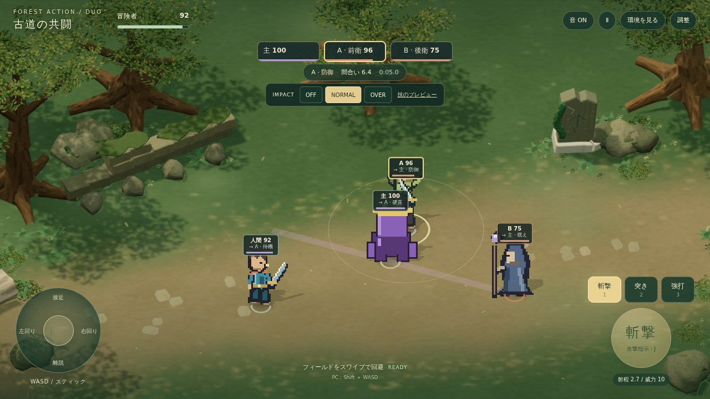
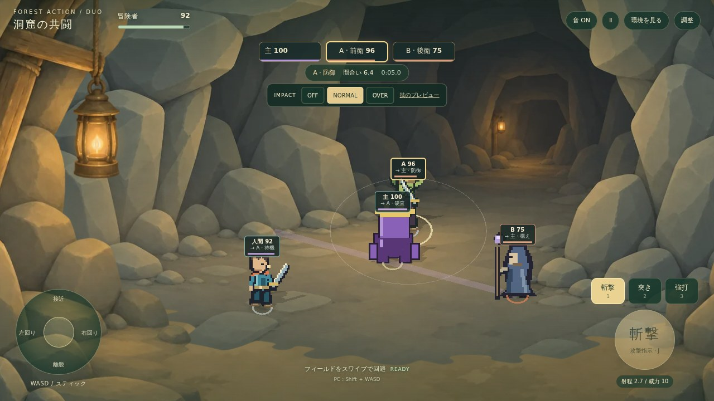

# Forest Action Duo validation

Validated build: 9df0e1af6077456fd6d772a909cd1fce540038aa

Validation run: https://github.com/tishiyama1/prototype/actions/runs/38270860627 (success)

## Verified public URLs

- https://tishiyama1.github.io/prototype/forest-action-duo/?scene=forest
- https://tishiyama1.github.io/prototype/forest-action-duo/?scene=cave

Chromium accessed the public Pages URLs directly, loaded the actual deployed application scripts and CDN Three.js 0.180.0, and started both scenes. No script/dependency interception was used in CI. Deterministic combat fixtures were injected only into this test browser for damage, defeat, and retry cases; they are not shipped in the playable application.

## Results

- 11 deterministic logic/protection groups passed.
- Both targets: 126 distance/state/technique conditions match the original resolver and all four card assessments exactly.
- 524 existing tracked files have their original SHA-256 values.
- Local Chromium: 18 browser check groups passed.
- Public Pages Chromium: 22 browser check groups passed, including both existing 1v1 pages and HTTP checks for the repository top page and hakaba.html.
- Four-actor scene boot, target HUD/Tab/head labels, WASD movement, selected-enemy-only card damage, frozen actor clocks/projectiles, skip/resume, real autonomous Lord attacks/stops and support shots, mobile swipes, 844x390/667x375 layout, one-enemy death/automatic selection, all-enemy win, retry, human KO/spectator mode, ally wipe, portrait notice were checked in both scenes.
- No application JavaScript errors in these cases. Missing legacy browser favicon.ico requests are separately identified; they are not game assets.

## Screenshots

The two screenshots were captured from the public Pages application after the same initial-state combat simulation reached about 5 seconds, then character progression was frozen without a pause dialog. The Lord had landed two attacks (24 damage) and one stop; the support enemy had fired a bolt. Both images show the same four-actor composition and HP values, at 1280x720. JPEGs are actual browser captures; lossless PNGs and mobile captures are also available in the validation run artifact.

## Limits / remaining prototype work

- Physical iPhone Safari, real-device FPS, thermal load and subjective touch comfort are untested. Chromium touch emulation is not an iPhone Safari device test.
- Role AI is intentionally simple and deterministic. Balance is provisional; being idle did not win in the model test, while an example approach/orbit/technique-selection strategy did win.
- Actor labels can crowd one another when units are close. Upper A/B buttons remain available for selection.
- Collision uses lightweight separation, not navigation/pathfinding or complex environmental obstacles.
- No healing, resurrection, interception/bodyguard special move, or coordination cards were added.
- Player damage/accuracy/counts retain the original definition; Lord contributions are separately reported.
